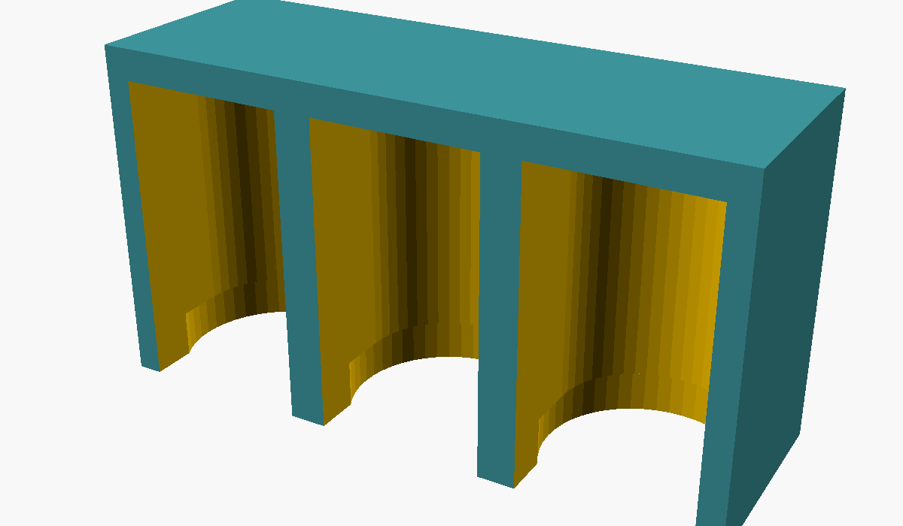
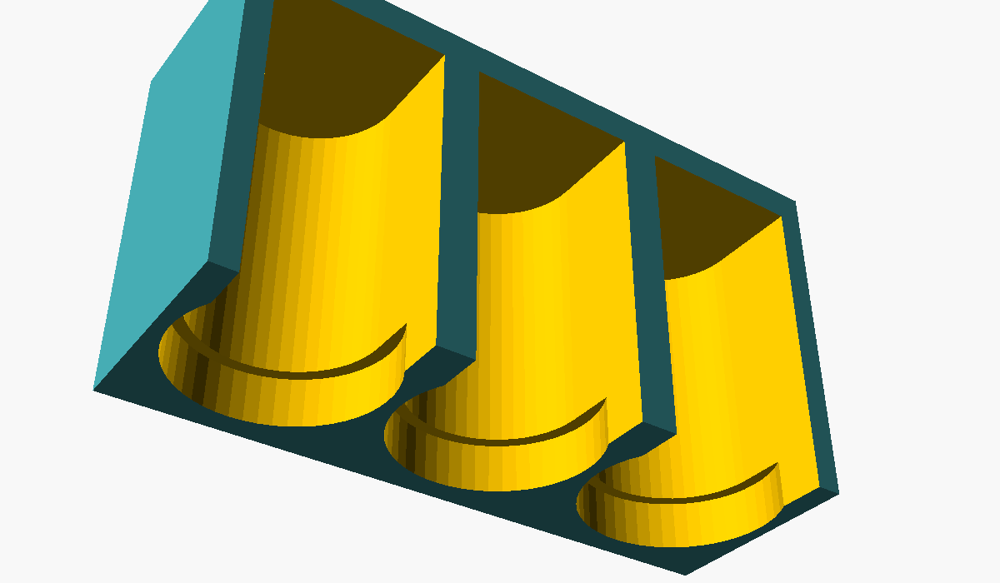

# LED comb for the AiO v4.5 boards

A small 3D-printed comb that keeps the light of the three front LEDs of the AiO v4.5 Micro and Standard (PWR/ETH, GPS/RTK, AS-ACT) apart. On the board the LEDs stand upright at the edge, 6.6 mm apart, so only 1.6 mm separates one dome from the next. In an enclosure with light windows on the front panel (the RayCorp case, for one) the light reaches each window from the side of the domes and spreads to the windows next to it: an orange LED beside a red one cannot be told apart. The comb slides down over the three LEDs and gives each one a cell that is closed on the top, the back and both sides, open only towards the panel, with the dividers reaching the panel.

| File | What |
|---|---|
| `led_bezel.scad` | The model, in [OpenSCAD](https://openscad.org/). Every size is a number at the top of the file. |
| `led_bezel.stl` | The model ready to slice and print, as the `.scad` is set. |
| `led_bezel.png`, `led_bezel_front.png` | What it looks like, from the panel side and from below. |

## Sizes as set

- Three cells of 5.4 mm, 6.6 mm apart (the pitch of the LEDs on both boards, from the pick-and-place files of the [official AiO v4.5](https://github.com/AgOpenGPS-Official/Boards/tree/main/TeensyModules)), 10 mm deep under a 1 mm roof.
- A 6.2 mm counterbore, 1.5 mm high, at the bottom of each cell for the LED's base flange.
- Dividers 1.2 mm thick (what the pitch leaves), back wall 1.2 mm, end walls 0.8 mm: on the Micro the RJ45 shield is about 1 mm from the AS-ACT LED and the fuse holder about 1.5 mm from the PWR/ETH LED.
- The front face 3.0 mm from the LED centres, that is at the board edge (3.05 mm from the centres on the Micro, 3.3 mm on the Standard). In the RayCorp case the board edge touches the front panel, so the dividers end against the panel.

Overall about 20 x 7 x 11 mm.

## Before printing: check one thing

If there is a gap between the board edge and the inside of the front panel in your case, add it to `front` so that the dividers just touch the panel. Dividers that stop short of the panel let the light leak across again; dividers that are too long keep the comb from sitting on the board, so a bit short beats a bit long. Everything else should fit as it is.

## Printing and fitting

- Print in **black or another opaque** filament, roof down on the bed, no supports. Opaque matters: the walls are there to stop one LED lighting the next window.
- Slide the comb down over the three LEDs, open side towards the panel, until it rests on the LED flanges. A tight print takes `hole = 5.6`.
- If it touches the RJ45 or the fuse holder, set `end_wall_right` or `end_wall_left` to 0.5, or sand that end.

## Without a printer

Wrap each dome with a strip of black insulating tape, about 8 mm wide, around the back and both sides, leaving only the side that faces the panel uncovered. Each LED then lights only its own window. A strip of black card folded into a comb between the LEDs and the panel does the same.

## Licence

CERN Open Hardware Licence Version 2 - Strongly Reciprocal (CERN-OHL-S v2) or later, as the AgOpenGPS boards it fits. No warranty.
