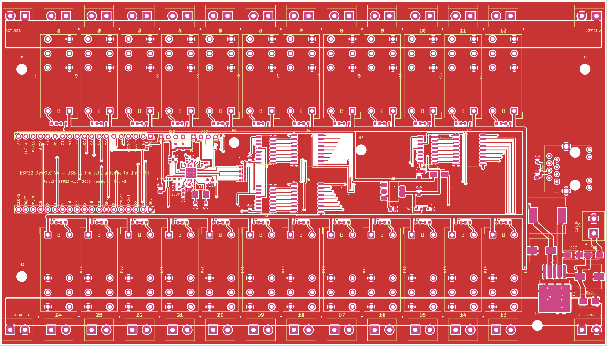

# Relay24_ESP32 - 24-section relay board for an ESP32 DevKitC

A 210 x 120 mm two-layer board that holds everything needed to drive 24 sections with
12 V linear actuators from AgOpenGPS / AgOpenWeb (machine module over UDP):

- an **ESP32 DevKitC V4** (38 pins) plugged into two 1x19 sockets, running
  [Seeder_ESP32](../Seeder/Seeder_ESP32) or [Sprayer_ESP32](../Sprayer/Sprayer_ESP32)
  with a board profile for this hardware (see *Firmware* below);
- **three 74HC595 shift registers + three ULN2803A** driving **24 DPDT relays**
  (HF115F/012-2ZS4, 8 A); each relay reverses one actuator: relay off = actuator pulled
  in (section closed), relay on = actuator pushed out (section open); a green LED per
  section;
- **RTL8201F + RJ45** (RMII; the PHY runs on its own 25 MHz crystal and feeds the 50 MHz
  reference clock into GPIO0) so the module can sit on the tractor network cable; Wi-Fi
  stays available;
- **12 V in** with reverse-polarity diode, TVS and bulk capacitor, **LM2596S-5.0 buck**
  to 5 V (DevKitC) and **AMS1117-3.3** for the logic and the PHY;
- the actuator power comes in on its **own terminals**, one pair of rails per relay row,
  so the 12 V for the actuators never flows through the logic supply.

Schematic: [Relay24_ESP32_schematic.pdf](Relay24_ESP32_schematic.pdf). Bottom view:
[pcb_bottom.png](pcb_bottom.png). The design has **not been built yet**; see *Before
ordering* at the end.

## Connections

All screw terminals are 5.08 mm KF301 blocks, wire openings towards the board edge.

| Terminal | Function |
|---|---|
| J1 .. J12 (top edge) | sections 1 .. 12, pin 1 = red wire, pin 2 = black wire of the actuator |
| J13 .. J24 (bottom edge) | sections 13 .. 24 (13 is under 12, 24 under 1) |
| J26, J27 (top edge, both ends) | 12 V ACT A: + and - of the actuator supply for sections 1-12 (feed from one end or both) |
| J28, J29 (bottom edge, both ends) | 12 V ACT B: same for sections 13-24 |
| J25 (right edge) | 12 V IN for the board and the relay coils (put a 2 A fuse in the wire) |
| J32 | RJ45, 100 Mbit, with magnetics and link / speed LEDs on the board |
| J33 | I2C header: 3V3, GND, SDA (GPIO15), SCL (GPIO14), with 4.7 k pull-ups |
| J34 | analog header: 3V3, GND, GPIO34, GPIO35 (0 - 3.3 V inputs) |

All grounds are common (board 12 V, actuator rails, ESP32). The relay contacts:
common 1 -> red wire, common 2 -> black wire; with the coil off the red wire is on GND
and the black wire on the actuator rail, with the coil on it is the other way round.
Swap the two wires of an actuator if it moves the wrong way.

## ESP32 pins

| Function | GPIO | Notes |
|---|---|---|
| 74HC595 data (SER) | 13 | three registers in a chain: U1 (sections 1-8) -> U2 (9-16) -> U3 (17-24) |
| 74HC595 clock (SRCLK) | 16 | |
| 74HC595 latch (RCLK) | 32 | |
| 74HC595 output enable (OE, active low) | 4 | 4.7 k pull-up: all relays off until the program drives it low |
| RTL8201F MDC / MDIO | 23 / 18 | PHY address 0 (strap resistors R32 / R36) |
| RMII TXD0 / TXD1 / TX_EN | 19 / 22 / 21 | |
| RMII RXD0 / RXD1 / CRS_DV | 25 / 26 / 27 | |
| RMII 50 MHz clock | 0 | input from the PHY (`ETH_CLOCK_GPIO0_IN`), 33 ohm series resistor; quiet at boot because the PHY is in reset |
| PHY reset / power | 33 | 10 k pull-down: the PHY stays in reset until the program sets it high |
| I2C | 15 (SDA), 14 (SCL) | header J33 |
| Analog | 34, 35 | header J34, input only |

Pins 2, 5, 12 and 17 are left free. GPIO0 carries the Ethernet clock, but only once the
program releases the PHY reset on GPIO33, so the DevKitC still boots and flashes normally
(GPIO0 is the only pin the ESP32 accepts the clock on).

## Firmware

[Seeder_ESP32](../Seeder/Seeder_ESP32) v0.2 runs this board (`BOARD_RELAY24`, its
default):

- sections through the 74HC595 chain (bit 0 = section 1): 24 bits on GPIO13 / GPIO16,
  relay 24 first, latch on GPIO32; GPIO4 goes low only after the chips hold zeros;
- Ethernet: `ETH.begin(ETH_PHY_RTL8201, 0, 23, 18, 33, ETH_CLOCK_GPIO0_IN)` with
  arduino-esp32 3.x (in 2.x the order is `ETH.begin(0, 33, 23, 18, ETH_PHY_RTL8201,
  ETH_CLOCK_GPIO0_IN)`); the driver lets the PHY out of reset before it starts the
  ESP32's network block, which needs the clock. Before a restart the program puts the
  PHY back in reset;
- the DevKitC's BOOT button is not read while the network cable is in use (GPIO0 carries
  the clock); `wifi-reset` on the Serial Monitor resets a forgotten Wi-Fi password;
- the LEDs next to the relays and the PHY LEDs need no code: D30 (yellow) lights for a
  10 Mbit link, D31 (green) for 100 Mbit, the chip's default LED mode (a program can
  change it through MDIO, page 7 register 19).

## Power

- 12 V IN: board logic + relay coils, about 0.1 A idle, up to 1.1 A with all 24 coils
  on (33 mA each). Reverse-polarity diode, 18 V TVS, 100 uF.
- Actuator rails: one 12 V feed per row of 12 relays; the copper rail is 9 mm wide on
  the top layer with a second strip on the bottom layer. Feed each rail from both ends
  (J26 + J27, J28 + J29) when several actuators may move at once, or order the board
  with 2 oz copper.
- The DevKitC can be powered from USB for programming on the bench: D28 keeps the USB
  5 V out of the buck converter.

## Files

- `Relay24_ESP32.kicad_pro`, `.kicad_sch` (+ three relay sheets), `.kicad_pcb`: KiCad 7
  project. `Relay24_ESP32_schematic.pdf`, `pcb_top.png`, `pcb_bottom.png`,
  `pcb_copper_*.png`: views.
- `fabrication_JLCPCB/`: `Gerber_Relay24_ESP32.zip` (Gerber + drill), `BOM_*_all.csv` /
  `CPL_*_all.csv` (every part) and `BOM_*_smd.csv` / `CPL_*_smd.csv` (surface-mount parts
  only, for an order where the relays, terminals, sockets and RJ45 are soldered by hand).
  JLCPCB format: BOM columns *Comment, Designator, Footprint, LCSC Part #*; CPL columns
  *Designator, Mid X, Mid Y, Layer, Rotation*.
- `tools/`: the generators. `design.py` holds every part, net and position;
  `make_sch.py` writes the schematic, `make_pcb.py` places and routes the board
  (`router.py` is a small grid router for the logic signals), `make_fab.py` writes the
  JLCPCB files and the views. Run them from the project folder with the Python of
  KiCad 7 (`python3 tools/make_pcb.py .`).

## Before ordering

Things that were assumed and should be checked on the real parts:

- The DevKitC V4 sockets are 25.4 mm apart (38-pin module). Measure your module; the
  30-pin DevKitC has another pitch and does not fit.
- The RJ45 is the HanRun HR911105A pinout (pairs on 1-2 and 3-6, centre taps 4-5 and
  7-8 to 3.3 V); another jack with built-in magnetics may differ. The PHY transmit pair
  pair (MDI pair 0) is wired to pins 1-2 and the receive pair (MDI pair 1) to pins 3-6,
  the usual wiring of an end device; the RTL8201F Auto-MDIX sorts out a crossed cable.
- The RTL8201F replaced the LAN8720A on 2026-10-28 because JLCPCB assembles the LAN8720A
  only on its Standard service (setup fee, wider board). The PHY runs on a 25 MHz crystal
  and sends the reference clock out; the ESP32 reads it on GPIO0. Nothing of this has
  been built yet.
- Y1 is a 5.0 x 3.2 mm two-pin crystal (YXC X503225MSB2GI, load capacitance 20 pF, with
  33 pF from each pin to ground). JLCPCB flags the smaller 3.2 x 2.5 mm four-pin crystal
  as hard to assemble and may charge extra for it, so do not swap it back.
- The screw terminals follow the KiCad `TerminalBlock_bornier-2_P5.08mm` footprint
  (wire opening on the pin-2 side); check the orientation on the first board.
- LCSC numbers were checked against the JLCPCB parts pages on 2026-10-28; stock
  changes, so a part shown as short at order time needs an equivalent with the same
  footprint. Second-source choices: the ULN2803 is Shanghai Belling (C22437476, same
  pinout as the TI ULN2803A), the LEDs are XINGLIGHT (the "green" ones are yellow-green,
  Vf 2.2 V, low enough for the Ethernet LEDs on 3.3 V).
- L1 is the SHOU HAN CYH127-33UH (12.3 x 12.3 mm) on KiCad's `L_12x12mm_H8mm` footprint
  (pads 2.9 x 5.4 mm, 9.9 mm apart): compare with the land pattern in its datasheet.
- The references of the resistors, capacitors and LEDs are not printed on the board
  (there is no room next to the PHY); the CPL files and the schematic have them.
- The CPL gives the centre of the body for the through-hole parts (relays, terminals,
  sockets, RJ45), as JLCPCB expects, and turns the 2.54 mm sockets and headers by 90
  degrees to match JLCPCB's models. The other rotations are KiCad's; check the JLCPCB
  preview, in particular the diodes, the electrolytic capacitors, the TO-263 regulator,
  the SOT-223 and the QFN.
- Linear actuators often draw 2-3 A while moving: size the actuator supply and the fuse
  accordingly.
