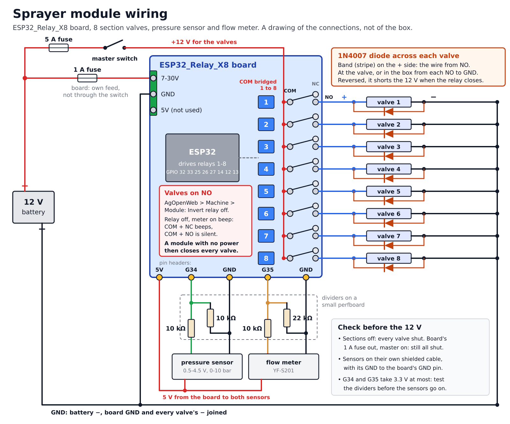
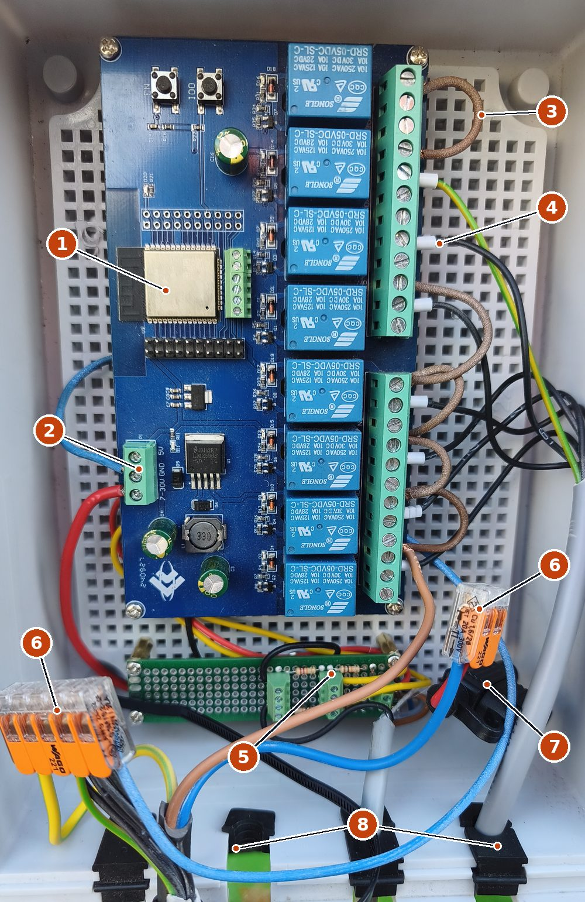

# Sprayer_ESP32

Section control for an 8 m sprayer boom with 8 sections of 1 m:

- driven by **AgOpenWeb** or **AgOpenGPS** over Wi-Fi
- on an **ESP32 8-relay board**
- it also measures boom pressure and flow
- it has its own web page

Version 0.10.21, the successor of [Sprayer_Nano](../Sprayer_Nano) v0.3. Tested on the bench; first used on the sprayer on 22 Nov 2026.

## Changelog

One row per day, in short; the details are in the sections of this file (the links). Older changes are in the git history.

| Date | What changed |
|---|---|
| 27 Nov 2026 | A wiring drawing with a 1N4007 diode across each valve, valves on NO (*Invert relay* off) so a module with no power closes them, the diodes in the parts list, a numbered photo of a built box ([Wiring](#wiring), [The box](#the-box)). |
| 24 Nov 2026 | **0.10.22**: an install checks the password before the file is sent ([The Firmware tab](#the-firmware-tab)). **0.10.23**: flow through the meter with every section closed is not counted as applied ([The litres applied](#the-litres-applied)). |
| 23 Nov 2026 | **0.10.18-20**: after a restart nobody asked for, the module says which watchdog, what it was doing, the last relay change, the crash record ([Why the module started](#why-the-module-started)). **0.10.21**: [dot at the top](#the-dot-at-the-top) orange when the program is silent. |
| 22 Nov 2026 | **0.10.15**, **0.10.17**: works on the AiO's XIAO WiFi with no router, subnet kept ([No router on the tractor](#no-router-on-the-tractor)). **0.10.16**: litres applied kept through a restart or a power cut; why it started is said ([How it works](#how-it-works)). |
| 21 Nov 2026 | **0.10.10-0.10.14**: names shown as text; a section with no relay is said ([How it works](#how-it-works)); three harness fixes; Wi-Fi reason, name and program checked; sensor unplugged, outputs inverted on screen ([Notes](#notes)). |
| 20 Nov 2026 | **0.10.9**: the own network's password is typed once: every box that asks for it and the *Network settings* field offer it again, also when the page is opened again in the same browser tab ([How it works](#how-it-works)). |
| 13 Nov 2026 | **0.10.7**: Enter in the *Network settings* password saves; an empty password or a held Enter answers no question. **0.10.8**: the Firmware tab in one card, and one box that says what a `.bin` holds before it is installed ([How it works](#how-it-works)). |
| 10 Nov 2026 | **0.10.6**: the tabs at the top of the page are 44 px high with 8 px corners, like the buttons of the page's question box: easier to hit on the cab's screen ([How it works](#how-it-works)). |
| 9 Nov 2026 | **0.10.5**: the page's questions (save and restart, install, password) in its own box: the browser's pop-ups show nothing inside an AgOpenWeb web card, so those buttons did nothing there ([How it works](#how-it-works)). |
| 7 Nov 2026 | **0.10.2**: add-on card (`_aowcard._tcp`) under its Wi-Fi name; `_aow-ui` and `/aow/status` gone. **0.10.3**: alarms also as PGN 221 ([Messages](#messages)). **0.10.4**: Module tab: Module card, one Network settings card. Code shared with the seed drill marked ([Notes](#notes)). |
| 2 Nov 2026 | **0.10**: rate (L/ha), target pressure and alarms worked out on the module and sent to the program (PGN 161); the page gets Spraying, [Settings](#setup), Module and Firmware tabs, with Install from GitHub. **0.10.1**: Wi-Fi settings as on the XIAO page. |
| 27 Oct 2026 | **0.7.1** sensor dividers from a common resistor kit. **0.7.2** the page says which sensors there are. **0.8** up to 64 sections, relays from any section. **0.9** sprayer boards only (the seed drill got its own folder). **0.9.1** PGN 237 in the AiO v26 layout. |
| 26 Oct 2026 | **0.6**: all 8 relays are sections by default. **0.7**: also a plain ESP32 with [relay modules](#a-separate-esp32-with-relay-modules), up to 16 relays. The relay number above its function on the page. |
| 25 Oct 2026 | **0.4**, first version on the ESP32 8-relay board (after Sprayer_Nano 0.3): sections from the program, pressure and flow, readings to the program (PGN 160), [its own page](#how-it-works). **0.5**: program subnet set on the page. The page in the simulator. |

## How it works

```
Tablet (AgOpenWeb / AgOpenGPS)
   │  Wi-Fi (the tractor's router), UDP
   ▼
ESP32_Relay_X8 board ──► 8 relays ──► 8 solenoid valves (NC), one per section
   ▲
   ├── pressure sensor (GPIO 34) + flow meter (GPIO 35)
   └── own Wi-Fi network "Sprayer-xxxx" + web page (phone)
```

### On the network

- The ESP32 is the standard AgOpenGPS **machine module**, IP `<subnet>.123` on the tractor's Wi-Fi network. That is 192.168.5.123 until the program, or the page, says otherwise.
- It speaks the same messages as the official `Machine_UDP_v5` module:
  - sections (PGN 239 / 229)
  - machine config (238: relay polarity, lift times)
  - pin functions (236: what each relay does)
  - subnet (201)
  - hello (200 → 123) and scan (202 → 203)
- Everything the program sends is kept in flash, so it survives a power cut.

### Rate and alarms

The module works out:

- the **application rate (L/ha)**, from the flow, the speed (PGN 239) and the widths of the open sections (PGN 235, which AgOpenWeb sends; kept in flash)
- the pressure that gives the **target rate** at this speed
- the **alarms**: low or high pressure, flow outside the tolerance, flow with every section closed

The target rate, nozzles, pressure limits and flow tolerance are set on the module's page (*Settings*). The section widths stay in AgOpenWeb.

### What it sends to the program

Once a second it sends all of it to the program:

- PGN 160: pressure, flow, litres, master switch, sections open (as before).
- PGN 161: the same readings plus the rate, target, pressure for the target, pressure limits and alarms, as **ISOBUS process data** (DDIs, see *Messages*).
- With no sensor ticked it sends none of them: see *Sensors fitted* below.

The [AgOpenWeb fork with the sprayer readout](https://github.com/renatorgr/AgOpenWeb) shows them above the section buttons and sounds the alarms.

An alarm also goes to the program as PGN 221, the text message it shows on its screen. So the official AgOpenWeb (which reads no PGN 161) shows the alarm too:

- when it comes on or goes off
- every 10 s while it lasts

### Safety

- The valves are normally closed: no power = valve closed.
- No message from the program for **2 seconds** (Wi-Fi gone, tablet frozen): every section closes.
- The master switch cuts the 12 V to the relay COM terminals in the wiring. So it works even if the ESP32 or the tablet freezes.

### The litres applied

**The litres applied** are *Applied* on the Settings tab, and the total in PGN 160 and 161.

- They are kept in flash, saved:
  - every 10 s while they change
  - when they are set to 0
  - before a restart that is asked for
- So a restart or a power cut loses 10 s of spraying at most.
- Only **Total back to 0** (Settings, Sensors card) or the serial `total-reset` clears them: at a new tank or a new job.
- They count only what goes out of the nozzles: while a section is open, and for 3 s after the last one closes (the valves closing).
  - With every section closed the flow meter can still turn: water running back through it to the tank when the pump slows with the hoses under pressure, a tap left open, a leak.
  - That flow is not counted as applied (it was until 0.10.22). The alarm *flow with the sections off* tells about it, and *Flow pulses* still counts every pulse of the meter.

### Why the module started

**Why the module started** shows as *Last start* on the Module tab, the first line of the events, and in the report. The reasons:

- power on
- restart asked (the page, an update, the program's subnet, serial)
- supply voltage dropped (brownout)
- program crash
- watchdog, in three kinds:
  - *watchdog: interrupts stuck*: interrupts ran for too long, for example a flood of pulses on the flow input (GPIO 35) from electrical noise
  - *watchdog: a task stuck*: the half of the chip that runs the Wi-Fi had no time for its own work for 5 s (0.10.19 names the task that held it)
  - *watchdog (other)*

Shown in red, and on the program's screen for 30 s (*Sprayer module restarted: …*, PGN 221):

- a start nobody asked for
- a power on while the program is already asking for sections: the power cut in the middle of the work (a loose wire, a fuse)

While the module starts again every valve is closed for a few seconds.

Not shown there: a power on with every section off (the start of the day), and a restart asked for.

On the ESP32 the EN button reads as a power on.

**What it was doing before** (0.10.18). After a start nobody asked for (a crash, a watchdog, a voltage drop), the module also says what it was doing just before. It keeps a small record in a part of its memory that a restart does not clear (a power cut does). It shows:

- after *Last start* on the Module tab: *(before: up 1234 s, at the web page)*
- in the events, as the line after *start:*: `before: up 1234 s, at the web page, flow 85/s +0, heap min 120 kB, -61 dBm`
- in the report, as `before` in the status: `up`, `at`, `flowPerS`, `flowAfter`, `heapMin`, `rssi`, `apCl` (phones on its own network), `relays` (one bit per relay), `alarms`, `task0`, `task1`, `relaysMs`, `core0Ms`

How to read it:

- **at**: the step of the module's loop that was running: *program messages*, *the web page*, *own network DNS*, *serial monitor*, *IO0 button*, *sensors and relays*, *hydraulics*, *flow and rate*, *messages out*, *Wi-Fi watch*, *litres to flash*, *a restart*, or *between passes* (in the ESP32's own code, after a pass of the loop).
- **flow N/s +M**: N flow pulses in the last whole second, and M pulses counted after the loop's last pass. A huge M with *interrupts stuck* means a flood of pulses on the flow wire: noise from a valve or the pump, a flow cable next to a valve cable, a missing 1N4007.
- **heap min**: the least free memory since the start. Under about 20 kB points at memory.
- **dBm**: the tractor network's signal (0 when the module was on its own network only).
- **task0, task1** (0.10.19, *a task stuck* only): the task each half of the chip was running when the watchdog fired. Also in the events (`before: the watchdog found core 0 (Wi-Fi) on 'wifi', core 1 (loop) on 'loopTask'`) and after *Last start* (*Wi-Fi core on wifi*).
  - The watchdog watches core 0 only, the half that runs the Wi-Fi. The module's own loop runs on core 1, so *at* names where the loop happened to be, not the cause; a small *+M* after the flow pulses shows the loop was still running.
  - `task0` is the cause: *wifi* (the radio), *tiT* (the network: TCP/IP), *async_udp* (the DNS of its own network), *mdns* (its name on the network), *ipc0* (a flash write from the other half), *sys_evt* (Wi-Fi events).
- **relaysMs** (0.10.20): how many ms before the loop's last pass the relays last changed (`null`: not since the start). A few tens of ms points at the supply: the valve coils letting go, or the pump. Also in the events: `before: last relay change 30 ms, core 0 idle +0 ms (from the loop's last pass)`.
- **core0Ms** (0.10.20): when core 0, the Wi-Fi half, was last idle, from the loop's last pass.
  - About 0: the whole chip stopped at once (the supply, a crash).
  - Positive, a second or more: the loop stood still while the Wi-Fi half went on.
  - About −5000: the Wi-Fi half had no idle moment for 5 s (*a task stuck*).

After a power on, or a restart asked for, there is nothing to say: `before` is `null`.

**The crash record** (0.10.20). After a crash, the task watchdog's too, the chip writes in a flash area of its own the task that crashed, where in the program, and the calls that led there (ESP-IDF's core dump). A restart, a power cut and a program update keep it; the next crash writes over it. The module reads it at each start:

- the *Crash record* row on the Module tab: *none*, or *new, task async_udp, Task watchdog got triggered… (this program)*
- in the events, at the start after the crash only: `crash record, new: task 'async_udp' (this program), …` and `crash record: at 0x400d1234, from 0x400d5678 …`
- in the report, as `crash` in the status: `new`, `damaged`, `task`, `why` (the chip's words), `pc` (where), `bt` (the calls, the latest first), `prog` (the fingerprint of the program that crashed), `same` (this program or an older one); `null` when there is none

How to read it:

- **pc** and **bt** are addresses in the program. The `.elf` file of that version's compile turns them into the file and the line (`xtensa-esp32-elf-addr2line -pfiaC -e Sprayer_ESP32.ino.elf 0x400d1234`): send the report, Claude keeps the `.elf` of each version.
- **same** `false`: an older program wrote it, before an update.
- **damaged**: the chip stopped while writing it, as when the supply goes right after a crash.
- *watchdog (other)* writes no record of its own. It is the chip's own watchdog, which ESP-IDF arms only while the chip restarts or starts, so that restart did not finish. A new record at that start says a crash came first; none points at the supply.

### Sections with no relay

**Sections with no relay** never spray, while the program paints them as sprayed. That is a section of the boom (the tool's sections from PGN 235), or one the program asks for, that no relay follows.

The module says so:

- the page shows the sections in red (*Sections 7-8 have no relay*), with red dashes around them
- the log has a line
- the program's screen shows *Sprayer: sections 7-8 have no relay* (PGN 221): when it starts, when it changes, and every 60 s while the program asks for one of them

The usual causes:

- AgOpenWeb's pin config as it comes (pins 7–8 empty, see *Setup*)
- two relays on one section
- more sections than relays

### The web page

Its **own Wi-Fi network** is always on:

- Join `Sprayer-xxxx` (password `agopengps`) with a phone and the page opens by itself.
- Or go to `http://192.168.4.1/`. With the program subnet 192.168.4 it is `http://192.168.40.1/` ([No router on the tractor](#no-router-on-the-tractor)).

On the tractor network the same page is at `http://192.168.5.123/` or `http://sprayer.local/`. The module announces it by mDNS, so AgOpenWeb's web cards (⚙ › **Search the network**) list it by name in a second.

It has four tabs:

- **Spraying**:
  - the rate in L/ha against the target: green within 10 %, orange outside
  - the pressure, and the pressure that gives the target (or "slow down / speed up to … km/h" when the target needs a pressure outside the limits)
  - the sections and the alarms
- **Settings**:
  - target rate, nozzles, pressure limits, flow tolerance
  - the section widths received from AgOpenWeb
  - the sensors fitted and their calibration
  - Saving needs the own network's password, so nothing changes by a touch while driving.
- **Module**:
  - the link to AgOpenWeb, the relays, the events
  - the Wi-Fi settings, laid out as on the XIAO page, with *Search for networks*
  - Network names and the module's answers go into the page as text, never as markup: a network name may hold `<` and `>`.
- **Firmware**, as on the Teensy and XIAO pages. See [below](#the-firmware-tab).

Without the board, the page can be tried in the [simulator](https://renatorgr.github.io/Boards/sprayer/), rebuilt from this code on every change.

#### The dot at the top

The dot left of the title is checked every second:

- **green**: the module answers the page, and the program talks to it: a PGN 239 in the last 2 s (*program talking*)
- **orange**: the module answers, but the program is silent, so the sections stay closed (*program silent*)
- **red**: no answer from the module (*no answer from the module*)

The same three colours as the Teensy, XIAO and seed drill pages since 0.10.21. Before, red stood for both a silent program and no answer.

### The Firmware tab

One card with:

- the program installed (version, build date)
- the **version on GitHub** (the `Sprayer_ESP32.ino.bin` in this folder), tagged *newer*, *installed* or *older*. It is checked when the page opens, every 6 hours and with *Check now*.
- the two ways to install: **Install from GitHub** and **Install from a file…**
- the progress bar
- **Restart module**, at the bottom of the card

A second card, **Download the report**: the module's state, settings and events in one `.json` file, to send when something goes wrong. No passwords in it.

The phone or tablet asks GitHub, so it needs internet: open the page over the tractor network, not over the module's own Wi-Fi.

Each install and the restart are confirmed in one box. The box:

- says what the file holds (version, build date, board) against what runs now: newer, the same or older
- asks the own network's password, and checks it with the module **before** the file is downloaded or sent. A wrong one is said at once under the field (*Wrong password: nothing was sent*), and the box stays open to type it again. Before, it was only refused after the whole file had gone up.
- refuses, as soon as it is chosen, a `.bin` for another board, another module's program or the `.merged.bin`, with the reason

### The page's questions and the password

Every question the page asks (save and restart, install a program, the password) opens in a box of the page itself, not a browser pop-up. Inside an AgOpenWeb web card the browser's pop-ups show nothing, so those buttons did nothing there.

- Enter is its OK, but not in an empty password field.
- A held Enter answers nothing: the key that pressed a button cannot also confirm it.
- Enter in the password at the end of *Network settings* saves, as its button does.

The own network's password is typed once:

- Every box that asks for it (Save, *Total back to 0*, *Restart module*, an install) and the field at the end of *Network settings* offer it again.
- That lasts while the browser tab stays open, also after a reload or a web card closed and opened again.
- It is forgotten when the module refuses it. A new one saved in *Network settings* takes its place.

The tabs at the top are 44 px high, with the same 8 px corners as that box's buttons: a size a finger hits on the cab's screen.

## Hardware

| Part | Notes |
|---|---|
| ESP32_Relay_X8 board (303E32DC810) | ESP32-WROOM-32E, 8 × SRD-05VDC relays (10 A), LM2596 on board, **5–30 V DC in** |
| 8 × solenoid valve FPD-270A, one per section | 12 V, 0.3 A, NC, 0.2–8 bar, G1/2 |
| Pressure sensor 0–10 bar | 0.5–4.5 V output, powered at 5 V |
| YF-S201 flow meter | 5 V, about 450 pulses per litre, 1–30 L/min |
| USB-serial adapter (CH340 or FTDI), 3.3 V | Only for the first upload; later updates go over Wi-Fi |
| 3 × 10 kΩ + 1 × 22 kΩ resistors (¼ W) | Dividers for the two sensor signals |
| 8 × 1N4007 diodes | One across each valve ([Wiring](#wiring)) |

The relays switch **on when the pin is HIGH** (checked with `ESP32_Relay_Test`):
relay 1 = GPIO 32, 2 = 33, 3 = 25, 4 = 26, 5 = 27, 6 = 14, 7 = 12, 8 = 13.

## Pins to solder

Only two pin headers are needed (2.54 mm male pins, soldered from the back):

| Header | Pins | Used for |
|---|---|---|
| 6-pin row `IO0 GND GND RX TX 5V` | all 6 | first upload with the USB-serial adapter, 5 V for the sensors |
| 2 × 10 row from `GND 3V3` to `5V GND` | G34, G35, 3V3, GND, EN | sensors (G34 pressure, G35 flow), reset |

The other 2 × 10 row (G23, G22, G21 …) stays empty.

## Wiring

[](images/wiring.png)

The ESP32 pins take **3.3 V at most**. Both sensors run on 5 V, so each signal goes
through a divider, **10 kΩ in series** and then a resistor to GND:

- pressure: **10 kΩ to GND** (0.5). 0.5–4.5 V from the sensor becomes 0.25–2.25 V, where
  the ESP32 measures best. The page's calibration has this 0.5 as the divider.
- flow: **22 kΩ to GND** (0.69). A 5 V pulse becomes about 3.4 V, well above the 2.5 V
  the ESP32 needs to see a pulse, even if the meter has its own pull-up resistor.

Both values come in the usual ¼ W resistor kits. With other resistors, put the pressure
divider (to-GND ÷ total) in the page's calibration.

| Connection | Wire |
|---|---|
| Board `DC+` / `GND` (3-pin green terminal) | 12 V from the battery through a **1 A fuse**. Separate feed, not through the master switch |
| Pressure sensor red / black | 5V pin / GND |
| Pressure sensor green (signal) | 10 kΩ → **G34**, and 10 kΩ from G34 to GND |
| YF-S201 red / black | 5V pin / GND |
| YF-S201 yellow (signal) | 10 kΩ → **G35**, and 22 kΩ from G35 to GND |
| Valves | 12 V from the battery, 5 A fuse → master switch → relay COM. Relay NO (open with the relay off) → valve +. Valve − → GND. 1N4007 diode across each valve (stripe to +) |

- Use a separate shielded cable for the sensors, with its own GND wire back to the board.
- All grounds (battery, board, valves) joined together.
- On the tractor, solder the sensor wires or use a latching connector: Dupont jumpers
  come loose with the vibration.
- **The valves go on NO**, with *Invert relay* off in AgOpenWeb (*Machine → Module*; [Setup](#setup), step 5).
  - Relay off, multimeter on beep: COM beeps with NC, not with NO.
  - Then a module with no power, starting or restarting closes every valve.
  - Valves on NC with *Invert relay* on switch the same way with the sections, but every valve opens when the module has no power or restarts.
  - Check: every section off, every valve shut. Then pull the board's 1 A fuse with the master switch on: no valve may open.
- One **1N4007 diode across each valve**, the band (stripe) on the + side, the wire from NO.
  - Fit it at the valve, or in the box from each NO terminal to GND.
  - Without it, a valve gives a voltage spike each time its relay opens. The spikes wear the relay contacts and can restart the module.
  - Reversed, it shorts the 12 V when the relay closes, and the fuse blows.

## The box



A box as built on the sprayer (photo of 25 Nov 2026). The diodes are not in this photo: the [wiring drawing](#wiring) shows where they go.

1. ESP32_Relay_X8 board, screwed to the box's mounting plate.
2. Power terminal: 12 V in (red) and GND (blue).
3. Brown wire loops bridge the COM terminals, so every relay gets the 12 V for the valves.
4. Valve wires, with ferrules.
5. The sensor dividers on a small perfboard, with screw terminals for the sensor cable.
6. WAGO 221 lever connectors join the common wires.
7. In-line fuse holder.
8. Clamps at the bottom hold each cable (strain relief).

- A plastic box: Wi-Fi does not get through a metal one.
- The cables come in from the bottom, so water runs off them.

## First upload (USB-serial adapter)

1. Arduino IDE → *File → Preferences → Additional boards manager URLs*:
   `https://espressif.github.io/arduino-esp32/package_esp32_index.json`.
   *Tools → Board → Boards Manager*: install **esp32 by Espressif Systems**.
2. Board **ESP32 Dev Module**, default partition scheme. No libraries to install.
3. Power the board with 12 V. Adapter jumper on **3.3 V**. Three wires to the 6-pin header:
   - adapter TX → board **RX**
   - adapter RX → board **TX**
   - GND → **GND**
   - Leave the adapter's 5V/VCC unconnected.
4. *Tools → Port*: the adapter's COM port.
5. Hold **IO0**, press and release **EN**, release IO0. Click *Upload*. When it says
   "Hard resetting", press **EN** once.
6. Serial Monitor at **115200**: it prints `Sprayer_ESP32 v0.10.21` and `ready`.

"Failed to connect": TX and RX are probably swapped, or step 5 was skipped.

## Setup

1. **Join the module.** On a phone, join the Wi-Fi network **Sprayer-xxxx**, password **agopengps**. The page opens by itself (or open `http://192.168.4.1/`).
2. **Tractor Wi-Fi.** **Module** tab, card *Network settings*, under *Tractor Wi-Fi network*:
   - Tap *Search for networks*, then the router the tablet uses. That ticks *Join the tractor network*.
   - Type its password.
   - At the end of that card type the own network's password (**agopengps**), then *Save and restart the module*.
   - The header then shows `on <network> as 192.168.5.123`.
3. **Program subnet.** The module and the tablet must be on the same subnet: the first three numbers of the tablet's IP on that network (Wi-Fi settings on the tablet; a Starlink router gives 192.168.1.x, for example).
   - If it is not 192.168.5, type it under *Program network* in the *Network settings* card, then *Save and restart the module*. The header then shows `as 192.168.1.123`.
   - In AgOpenWeb set the module subnet to the same three numbers.
   - AgOpenWeb can also send its subnet to the module (PGN 201) once it sees it.
4. **Open AgOpenWeb.** The machine module shows up at `<subnet>.123`, and the page's dot turns green (*program talking*).
5. **Relay polarity.** In AgOpenWeb, *Machine → Module*, leave **Invert relay** off for this board (not *Invert relays* in the AutoSteer settings: that is the steering relay). The page's *Module* tab, *AgOpenWeb* card, shows *Output polarity: normal*. If it says *inverted*, switch *Invert relay* off.
6. **Sections.**
   - On the module, relays 1–8 are sections 1–8 by default, so the board is ready for an 8-section boom.
   - But AgOpenWeb sends its own pin config to the module at start and on profile load. Its default is pins 1–6 = sections 1–6, pins 7–8 = none.
   - So in AgOpenWeb set *Tool → sections* to the number of sections on the boom (8, each 1 m wide).
   - And set *Machine → Pin config* pins 7 and 8 to *Section 7* and *Section 8*. Without that, relays 7 and 8 never open.
   - A relay that is not a section can be the hydraulic lift or the tramline instead.
   - The page's *Relays* card shows what each relay does.
7. **Sensors fitted.** In *Settings → Sensors*, tick *Pressure sensor fitted* and *Flow meter fitted* for the sensors on the machine (both on the sprayer, ticked by default), then *Save*.
   - The page only shows the readings and calibration fields of the sensors ticked.
   - An unticked sensor reads 0 (its pin floats without it).
   - With **neither ticked** the rate and pressure go away, and the module stops sending PGN 160 and 161. Then AgOpenWeb's sprayer strip and the AiO module page's *Sprayer (PGN 160)* card do not show. The sections still reach them in the hello reply.
8. **Section widths.** *Settings → Sections from AgOpenWeb* should say *8 sections of 1.00 m*.
   - AgOpenWeb sends them (PGN 235) when it starts and when a tool profile is saved or loaded. The module keeps them.
   - If it says *not received yet*, save the tool profile in AgOpenWeb with the module on the network.
   - Without them there is no L/ha.
9. **Spraying settings.** In *Settings → Spraying*, type:
   - the target rate (L/ha)
   - the nozzle spacing (0.5 m: 2 nozzles per 1 m section)
   - one nozzle's flow at a pressure, from the nozzle chart
   - the minimum and maximum pressure and the flow tolerance
   - then *Save*.

   These used to be in AgOpenWeb (*Machine → Sprayer*). With this module AgOpenWeb hides them and shows what the module sends.

### Later program updates

On the page's **Firmware** tab:

- **Install from GitHub** when the version there is tagged *newer*: the page downloads `Sprayer_ESP32.ino.bin` from this folder on GitHub and sends it to the module.
- Or *Sketch → Export compiled binary* in the Arduino IDE, then **Install from a file…** (`Sprayer_ESP32.ino.bin` in the sketch folder, not the `.merged.bin`), and *Install* in the box that says what the file holds.

The page knows which version is on GitHub from the `.bin` itself: its version, board and build date, published in `firmware.json` with the simulator. So after a code change, export the binary again and put the new `.bin` files on GitHub with the code. Otherwise the page keeps offering the older program.

## No router on the tractor

Since 0.10.15 the module also works on a tractor with no router. The tablet is then on the Wi-Fi of the AiO board's XIAO, with its WiFi bridge on (the XIAO program's README, *Section modules on the XIAO's WiFi*).

**Not tried on a real module yet.** The harness (`Tests/ESP32_Modules`) plays it with a pretend XIAO, late and lost packets included.

1. On the module's page, *Network settings*, under *Tractor Wi-Fi network*:
   - Join the **XIAO's network** (`XIAO-xxxx`) with its password.
   - Keep the *Program subnet* as it is (**192.168.5**). With its bridge on, the XIAO's network has the AiO module's numbers (the XIAO program's README, *The XIAO's network numbers*).
   - *Save and restart the module*.
2. Open AgOpenWeb on the tablet.
   - The XIAO sends the module a copy of each packet of the program, to the module's own address.
   - It passes the module's packets on to the tablet.
   - The Module tab's *Program* row then says *talking · through the access point (192.168.5.1)*. The events say it too.

The first XIAO program with the bridge (22 Nov 2026, 16:03 UTC) had its network at 192.168.4.x, and the module was set to the subnet 192.168.4. Set it back to 192.168.5.

With the subnet 192.168.4, the module's own network moves from 192.168.4.1 to 192.168.40.1: two networks with the same numbers on one module leave neither working. The page shows the address in use (*Module* card, *Network settings*).

While the XIAO's copies come:

- The module sends to the XIAO only, not to everyone on the network.
- The program's own packets "to everyone" are left alone. A Wi-Fi access point holds those back, and they arrive late beside the copies: an old section state after a newer one would switch a relay back for a moment. The *Messages* row counts them (*late broadcasts left alone*).
- When the copies stop (the XIAO restarts, its bridge is switched off), every section closes within 2 s, as with any lost link. A second later the module listens to everyone again.

The same goes for a tablet whose **own hotspot** is the tractor network. The program is then at `<subnet>.1`, and the module answers that address only.

From the tablet, on the XIAO's network, the page is at its usual address, `http://192.168.5.123/`.

## Bench test (before the tractor, no water)

1. Only the board, valves disconnected. With the program closed the relay LEDs must be
   **off**.
2. Join the tractor network (Setup above). In AgOpenWeb turn sections on from the screen:
   each relay should click and its LED light up, and the page shows them green.
3. Switch the tablet's Wi-Fi off: all relays switch off within 2 seconds, the page says
   *program silent, sections closed*.
4. Blow through the flow meter: the flow on the page goes above 0.
5. Press on the pressure sensor's connector pins with nothing attached: the sensor
   voltage shown should sit near 0.5 V (0 bar).

## Calibrating the flow meter

1. With the pump running and one nozzle open, fill a 10 L bucket.
2. Note the litres the page counted.
3. New pulses per litre = old value × (litres counted ÷ 10).
4. Enter it under *Settings → Sensors* on the page (it needs the own network's password).

## Forgotten Wi-Fi password

Hold the **IO0** button for 5 seconds while the board is running:

- The Wi-Fi settings go back to the defaults (`Sprayer-xxxx`, `agopengps`, no tractor network) and the board restarts.
- The program's config and the calibration stay.

The same from the Serial Monitor: `wifi-reset`.

## Messages

| PGN | Direction | What |
|---|---|---|
| 239 | program → module | sections 1–16 (bytes 11–12), hydraulic lift (7), tramline (8), geo stop (9), speed (6, km/h × 10) |
| 229 | program → module | sections 1–64 (bytes 5–12, 8 per byte, section 1 = byte 5 bit 0), sent with every 239 when the tool has more than 16 sections. The relays here follow sections 1–16 only (the program's pin config) |
| 238 | program → module | machine config: raise / lower time, lift enable, byte 8 bit 0 = outputs inverted. Saved |
| 235 | program → module | section dimensions: widths of sections 1–16 in cm (uint16, bytes 5–36), number of sections (37). For the L/ha. Saved |
| 236 | program → module | 24 output functions: 1–16 section, 17 lift lower, 18 lift raise, 19 tramline right, 20 tramline left, 21 geo stop. Saved |
| 201 | program → module | subnet; the module restarts as `<subnet>.123` (or the last number set on the page). Saved |
| 200 → 123 | hello / reply | reply carries the sections 1–16 really open (bytes 5–6) |
| 202 → 203 | scan / reply | the module's IP |
| 237 | module → program | every 200 ms, in the layout of the AgOpenGPS AiO v26 firmware: sections 1–16 open (5–6), lift (7: 0 off, 1 down, 2 up), tramline (8), geo stop (9), status (10: bit 0 = the program's PGN 239 still arrives) |
| 160 | module → program | once a second, only with a sensor ticked: pressure (bar × 100), flow (L/min × 100), total (L × 10, uint32), master switch, sections open 1–8 (byte 14) and 9–16 (byte 15). See `Docs/PGN.md` of the AgOpenWeb fork, which reads byte 14 |
| 161 | module → program | right after each 160: ISOBUS process data, 8 bytes per value (table below) |
| 221 | module → program | the text message the program shows on its screen, as the AiO Teensy sends it. When it is sent: [below](#pgn-221-the-text-message) |

All messages:

- header `0x80 0x81`
- source `0x7B` from the module
- checksum = sum of the bytes from the source byte to the one before the checksum

The module only accepts messages with a right checksum from source `0x7F` (the program).

### PGN 221, the text message

Byte 5 is the seconds to show, byte 6 the colour (0 warning, 1 normal), the text from byte 7 (60 bytes at most).

The module sends it:

- when a section has no relay (*Sections with no relay* in [How it works](#how-it-works))
- when an alarm comes on or goes off, and every 10 s while one is on
- once after a start nobody asked for (*Why the module started* in [How it works](#how-it-works))

The official AgOpenWeb shows it. The fork has the alarms from 161 as well.

### PGN 161, ISOBUS process data

As the Process Data Message of ISO 11783-10, which the AgOpenGPS ISOBUS group proposes for modules ("ISOBUS Data Everywhere").

Each value is 8 bytes, little-endian:

- byte 0: command 3 (*value*) in bits 0–3, and the element number's bits 0–3 in bits 4–7
- byte 1: the element number's bits 4–11
- bytes 2–3: the DDI
- bytes 4–7: the value (int32)

Element 0 = the sprayer, element 1 = its boom.

A value that is not known (sensor not fitted, tractor stopped, no target) is left out of that message.

| DDI | What | Unit (value = ) | Element | Sent |
|---|---|---|---|---|
| 194 | actual pressure | 0.1 Pa (bar × 1 000 000) | 1 | pressure sensor fitted |
| 37 | actual flow | mm³/s (L/min × 16 667) | 1 | flow meter fitted |
| 351 | total volume | ml | 0 | flow meter fitted |
| 141 | actual work state (master switch) | 1 on, 0 off | 1 | always |
| 161 | actual condensed work state, sections 1–16 | 2 bits per section: 01 open, 00 closed, 11 not there | 1 | always |
| 2 | actual rate | 0.01 mm³/m² (L/ha × 10 000) | 1 | moving, widths known, flow meter fitted |
| 1 | target rate | 0.01 mm³/m² (L/ha × 10 000) | 1 | target set |
| 193 | pressure that gives the target now | 0.1 Pa | 1 | moving with a target |
| 195 / 196 | minimum / maximum pressure | 0.1 Pa | 1 | when set |
| 57344 | sprayer alarms (proprietary DDI): 1 low pressure, 2 high pressure, 4 flow too low, 8 flow too high, 16 flow with the sections off | bits | 1 | always |

## A separate ESP32 with relay modules

The same program runs on a plain ESP32 dev module (30 or 38 pins) with one or two relay modules, for up to **16 relays**.

At the top of `Sprayer_ESP32.ino` set `#define BOARD BOARD_DEVKIT`. Then:

| | ESP32_Relay_X8 board | ESP32 dev module + relay modules |
|---|---|---|
| Relay pins | 32, 33, 25, 26, 27, 14, 12, 13 | 4, 5, 13, 14, 16, 17, 18, 19, 21, 22, 23, 25, 26, 27, 32, 33 (relay 1 first; shorten the list to the relays you have) |
| Relay closes when the pin is | HIGH (`RELAY_ON_HIGH 1`) | LOW on the usual optocoupled modules (`RELAY_ON_HIGH 0`); set 1 for a module with high-trigger jumpers |
| LED | GPIO 23 | GPIO 2 (the blue LED) |
| Sensors | G34 pressure (10k / 10k), G35 flow (10k / 22k) | the same pins and dividers |
| Power | 5–30 V DC on the board | 5 V to the dev module's `5V`/`VIN` pin from an LM2596; the relay module's `JD-VCC` from the same 5 V (jumper off), its `VCC` from the ESP32's 3V3, GND to GND |

Wiring the relay module:

- `IN1`…`IN16` to the pins above, in order
- one common GND
- the 12 V for the valves goes through the master switch to the relays' COM, as on the X8 board

**Which relays are sections** is decided by the program, not by the module:

- In its pin config, every pin marked *Section n* makes relay n open with section n.
  - AgOpenGPS: *Machine → Pin config*, default pins 1–16 = sections 1–16.
  - AgOpenWeb: *Machine → Pin config*, default pins 1–6 = sections 1–6.
- The page's *Relays* card shows the result ("16 relays, 8 of them sections").
- A relay that is not a section can be the hydraulic lift or the tramline.
- The AgOpenWeb sprayer strip shows the first 8 sections. The module reports all 16 (PGN 160 byte 15, PGN 161 DDI 161).

If a relay module closes on HIGH instead of LOW, either set `RELAY_ON_HIGH 1` or switch on *Invert relay* in the program (AgOpenWeb: *Machine → Module*). The page's *Output polarity* line says which pin level the module is using.

## Notes

- **0.10.23**: on 22 Nov 2026 the litres applied went up at the end of a job with every section closed.
  - No tap was open: the water ran back through the flow meter to the tank when the pump slowed, with the hoses at 6-7 bar, and the module counted it as applied.
  - Now the litres count only while a section is open and for 3 s after (*The litres applied* in [How it works](#how-it-works)).
  - Tested in `Tests/ESP32_Modules` (scenario *sprayer-litres-sections-closed*): a minute of water running back adds no litres; the alarm comes on and the pulses still count.
- **0.10.21**: only the page. Its [dot at the top](#the-dot-at-the-top) is orange when the module answers but the program is silent (it was red, as with no answer), as on the Teensy, XIAO and seed drill pages.
- **0.10.19**: on 23 Nov 2026 at 15:17, 16:22 and 16:28 the module restarted with *watchdog: a task stuck*.
  - At 16:28 it was *at the web page* with *flow 262/s +1*: the loop was running, so the half of the chip that runs the Wi-Fi was the one stuck for 5 s.
  - Now the watchdog keeps the task each half was running (`task0`, `task1` in *What it was doing before*), so the next restart names the part of the Wi-Fi that held it.
  - Tested in `Tests/ESP32_Modules` (scenario *sprayer-restart-says-before*): the bench calls the program's watchdog hook with the Wi-Fi task on core 0.
- **0.10.18**: on 23 Nov 2026 at 11:58 the module restarted by itself in the middle of a job, the third time in two days. *watchdog* was all it could say.
  - The litres were kept (0.10.16), so the job went on.
  - Now it names the watchdog and keeps what it was doing (*What it was doing before* in [Why the module started](#why-the-module-started)), to find the cause the next time.
  - Tested in `Tests/ESP32_Modules` (scenario *sprayer-restart-says-before*): the bench keeps that memory through a restart and clears it at a power cut.
- **0.10.17**: only words on the page. On the XIAO's WiFi the subnet stays as it is (192.168.5), since the XIAO's network takes the AiO module's numbers with its bridge on.
- **0.10.16**: on 22 Nov 2026 the litres applied went back to 0 in the middle of a job.
  - The sections were put On by hand in some turns, and nothing was restarted by hand.
  - The count lived in RAM only, and nothing but a start of the module (or *Total back to 0*) clears it. So the module had started again by itself, and did not say why.
  - Now the litres are kept (*The litres applied* in [How it works](#how-it-works)) and the module says why it started.
  - A restart by itself while many valves switch points at the supply: a drop of the 12 V (a thin or long cable, a bad crimp or fuse holder), or the valves' spikes (a 1N4007 missing or reversed).
- **0.10.15**: a tractor with no router ([No router on the tractor](#no-router-on-the-tractor)).
  - With the program subnet 192.168.4 the own network is at 192.168.40.1.
  - Packets of the program that come from the network's own address (`<subnet>.1`: the XIAO's WiFi bridge, or a tablet's hotspot) are answered to that address only.
  - The same packets arriving late "to everyone" are left alone and counted.
- **0.10.14**:
  - A pressure sensor ticked on the page that reads under 0.3 V for 3 s is not there (a 0.5–4.5 V sensor gives 0.5 V at 0 bar). The page, the log and the program's screen say *pressure sensor unplugged?* instead of *low pressure 0.0 bar*, which read like a pump problem.
  - On the ESP32_Relay_X8, whose relays close one way only, *relay active high* ticked in the program (every valve open with no section asked) is said on the program's screen every 10 s. Not on a dev module, where some relay modules do close on HIGH.
- **0.10.13**:
  - The page says why the tractor network was not joined (*the password looks wrong*, *no network of that name in range*, *the signal was lost*), and the log says it once.
  - The module's name takes only letters, digits and `-` (a space made `http://my sprayer.local/` unreachable).
  - A program update that holds the other module's program is refused by the module itself, not only by the page.
- **Fixed in 0.10.12**, found by the module harness (`Tests/ESP32_Modules`):
  - A raise or lower time over 51 s ran short (60 s gave 8.6 s; now up to the 255 s AgOpenWeb allows).
  - The calibration save takes only digits for *Sensors fitted* (`abc` used to save "no sensors").
  - An "outputs inverted" byte in flash other than 0 or 1 reads as normal (7 used to close every relay).
- `USE_MASTER_SWITCH` (top of `Sprayer_ESP32.ino`): set to 1 to read the master switch on **G39** (12 V through 47 kΩ, then 10 kΩ to GND). Off by default: the switch cuts the valves' 12 V in the wiring.
- `LED_PIN` is 23 on the X8 board. If its LED does not blink, that is not the right pin: set it to the right one or to −1.
- The FPD-270A valves and the YF-S201 are plastic and made for water.
  - Rinse with clean water after each job.
  - Fit a filter before the flow meter.
- The seed drill module (`Seeder/Seeder_ESP32`) grew out of this program.
  - The Wi-Fi, the web helpers, the network settings, the PGN handling and the relay driving are the same code in both. They are marked in the sources as `// ==== shared "name"` … `// ==== end shared "name"`.
  - A change to one of those blocks goes in both programs. The "Shared code" check (`.github/scripts/check_shared_blocks.py`) compares them on every pull request.
  - The sensors, the rate and the alarms are this program's own.
- The ISOBUS group of AgOpenGPS is working on a standard way for modules to send such readings (ISOBUS DDIs).
  - PGN 161 follows that proposal. The PGN number itself is this project's choice until the group picks one.
  - The module keeps sending PGN 160 for the AiO module page and older AgOpenWeb builds.
- The page is announced over mDNS in two ways, both under the module's own Wi-Fi name (`Sprayer-xxxx`, "Name on the network" on the Firmware tab), unique to each module:
  - as `_http._tcp`, for the AgOpenWeb fork's **Search the network**
  - as `_aowcard._tcp` with TXT `v=1` and `path=/`, the official AgOpenWeb add-on card announcement (`Docs/ADD_ON_CARDS.md`)
  - The earlier `_aow-ui._tcp` and `GET /aow/status` (0.10.0 and 0.10.1) are gone.
